# SysDeck

  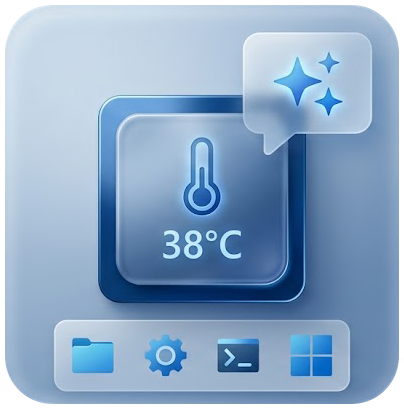

  Desktop widgets for Windows + a Nintendo Switch turned into a USB touch screen / stream deck.

---

SysDeck (WPF, .NET 8) shows widgets pinned to the desktop (below windows, like desktop icons):

hardware monitoring, audio, now playing, clocks, calendar, weather, power cost in euros, a shortcut bar, Claude usage quota, and AI text correction. Everything can be customized from the Settings window.

With the **SwitchDeck payload**, a Nintendo Switch plugged in over USB-C becomes a second 1280×720 touch screen: the PC renders the modules and tiles, while the Switch displays them and sends touch input back.

Tiles, drawn as Stream Deck-style **3D glass buttons**, can also control **OBS Studio**, **Twitch**, and **Voicemod**, and run **plugins**: SysDeck plugins and open-source **Elgato Stream Deck** plugins installed from a GitHub catalog.

The Joy-Con attached to the Switch can trigger SysDeck actions too.

> The user interface is in French.

## Screenshots

<table>
  <tr>
    <td width="30%" valign="top">
      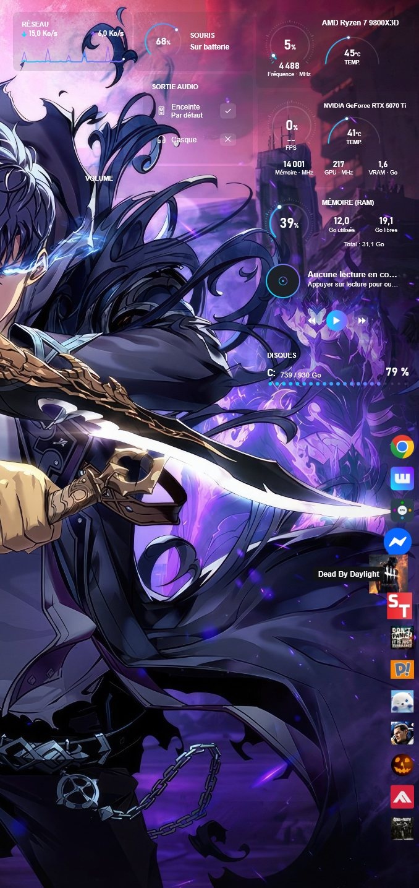
       
      Desktop widgets
    </td>
    <td valign="top">
      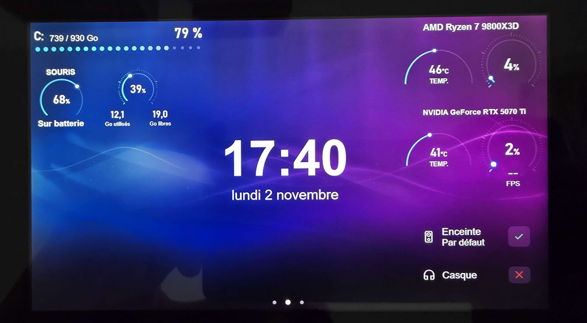
       
      The Switch plugged in over USB-C: live hardware stats, clock and audio output
    </td>
  </tr>
</table>

<b>More screenshots</b>

| | |
|---|---|
| 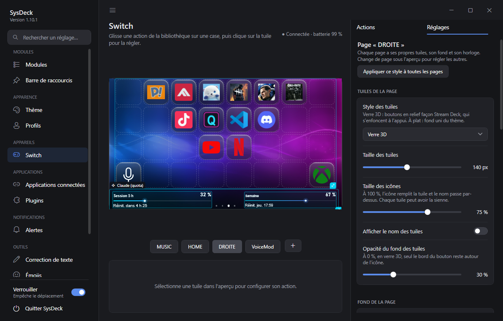 Switch page: live preview, pages, tile inspector and icon editor | 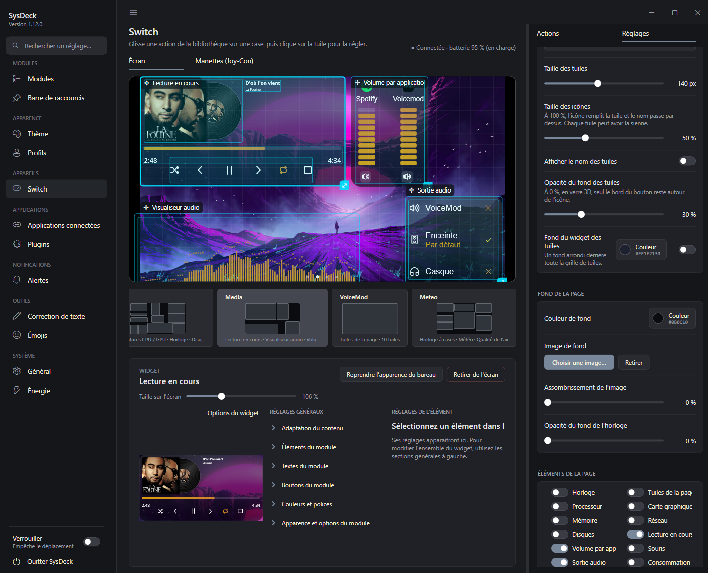 Click a widget in the preview: all of its Switch settings below |
| 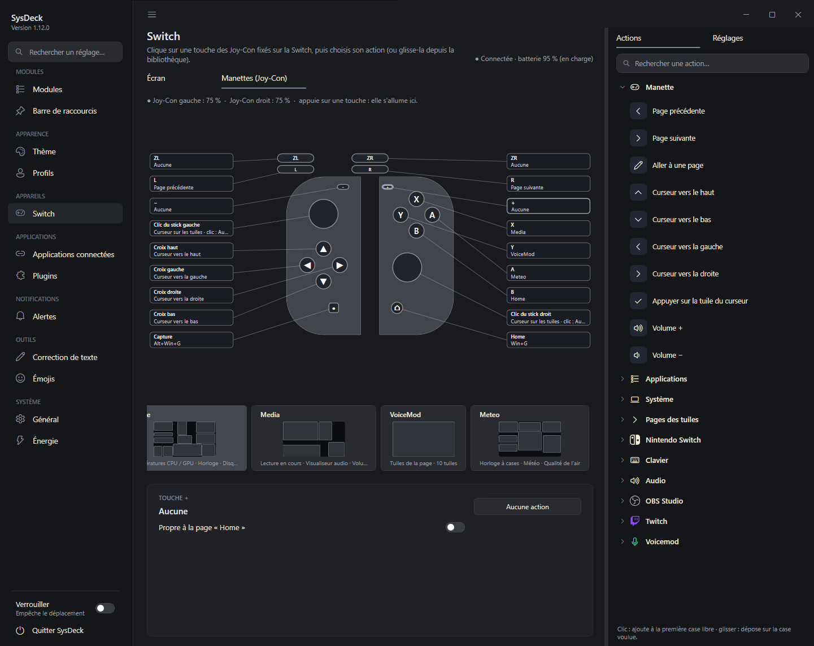 Joy-Con view: an action for each button, per page if needed | 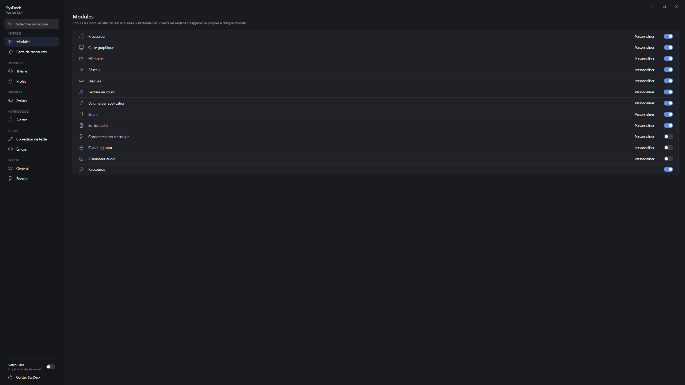 Module selection |
| 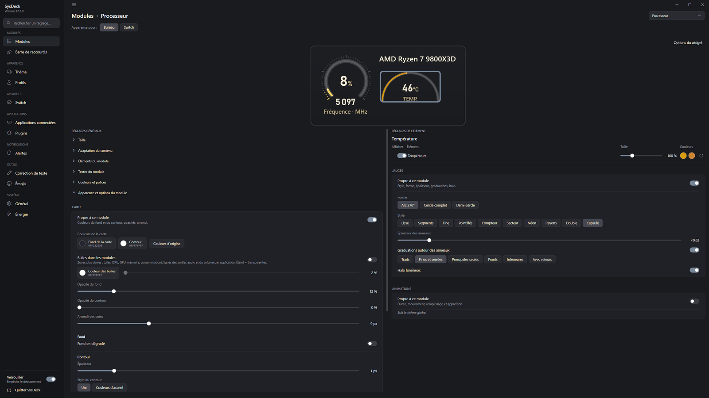 Module customization: clickable preview, card, gauges, animations | 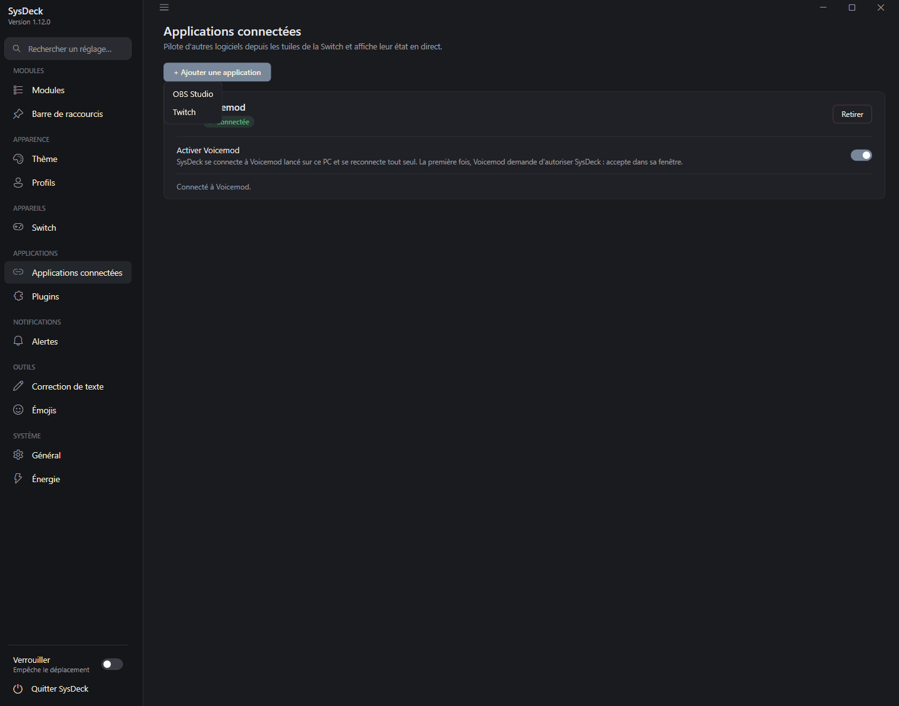 Connected apps: OBS Studio, Twitch, Voicemod |
| 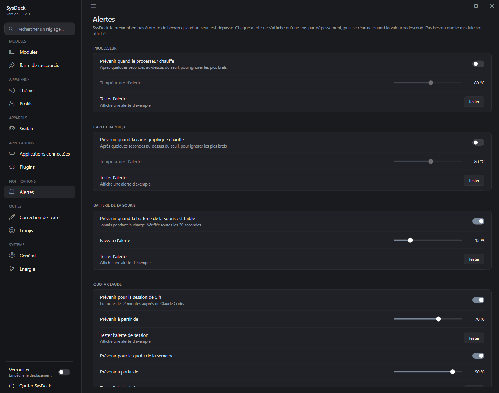 Alerts: CPU and GPU temperature, mouse battery, Claude quota | 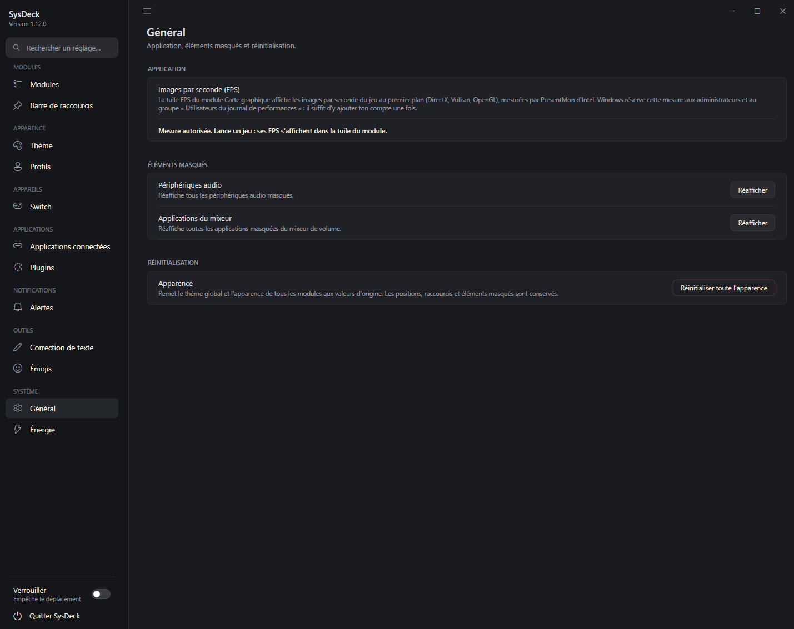 General: FPS measurement, hidden items, reset |

## Contents

- [Modules](#modules)
- [Compatibility](#compatibility)
- [Switch module (SwitchDeck)](#switch-module-switchdeck)
- [Connected apps (stream deck)](#connected-apps-stream-deck)
- [Plugins and icon packs](#plugins-and-icon-packs)
- [Building](#building)
- [Repository layout](#repository-layout)
- [Data](#data)
- [Troubleshooting](#troubleshooting)
- [Licenses and credits](#licenses-and-credits)

## Modules

| ID | Module | Data source |
|---|---|---|
| `cpu`, `gpu`, `ram` | CPU, GPU, memory | LibreHardwareMonitor (+ `Tools/CpuTempBridge.ps1` for AMD CPU temperature) |
| `network` | Network throughput | Network interface counters |
| `disk` | Drives | `DriveInfo` |
| `media` | Now playing: 4 layouts, time bar, shuffle/repeat | Windows.Media.Control API (Spotify, browsers, VLC…) |
| `volumemixer` | Per-app volume | Core Audio (NAudio) |
| `audio` | Audio output | Core Audio + IPolicyConfig |
| `mouse` | Logitech mouse battery | HID++ 2.0 (HidSharp) |
| `power` | Power cost in € | Measured GPU power, estimated CPU, Windows event log for history |
| `claude` | Claude usage quota | Claude Code token (read only) |
| `visualizer` | Audio visualizer | Audio output capture (NAudio) |
| `tileclock` | Digital clock on colored tiles (HH:MM:SS) | System clock |
| `analogclock` | Analog clock with date | System clock |
| `calendar` | Month calendar | System clock |
| `weather` | Weather and 4-day forecast | Open-Meteo (free, no account) |
| `moon` | Moon phase: real Moon picture shaded to the current phase, phase name, illumination, next phases | Computed offline (Meeus terms, within a few hours) |
| `sun` | Sunrise and sunset: sun path, times, day length, next event | Open-Meteo, same city as the weather |
| `airquality` | Air quality (European AQI, PM2.5, PM10, NO₂, O₃) | Open-Meteo, same city as the weather |
| `temperatures` | CPU and GPU temperature curves on one chart | LibreHardwareMonitor |
| `sensorbars` | Bars for any sensor (temperatures, loads, RAM, VRAM, fans…) | LibreHardwareMonitor |
| `simhub` | Sim racing: gear, speed, RPM, lap times, position, fuel | SimHub + the SimHub Property Server plugin |
| `shortcuts` | Shortcut bar | `shortcuts.json` |

### Additional features

- **AI correction**: select text in any application and press **Ctrl+Space**. A Gemini API key must be set in Settings.
- **Emoji picker**: a global hotkey (chosen in Settings) opens a picker near the cursor with categories, search, and recent emojis. The selected emoji is typed into the active application. Emojis can also be used as icons for Switch tiles.
- **Desktop customization**: right-click a module to customize it, resize it or its text, edit the layout, lock positions, or hide it. Use **Ctrl + mouse wheel** to scale it.
- **Profiles and themes**: save, export, and import `.sysdeckprofile` files. Includes 9 built-in themes, including "Edge noir": matte black cards, thin gauges, and an orange accent.
- **Module settings**: clocks, weather, air quality, temperature, sensor bar, SimHub, and media options are in each module's customization page under the Style tab. New modules are hidden until enabled.
- **Now playing**: Compact, Banner (large cover), Vinyl (spinning record with the cover as its label), or Sleeve (cover with the record sliding out) layouts. Supports thin, thick, or segmented time bars (click to seek), buttons with or without backgrounds, shuffle, and repeat. Cover, track, time bar, and buttons can be moved.
- **Sensor bars**: choose any reading, with one horizontal or vertical bar per sensor. Supports segmented, solid, or gradient bars, individual bar colors, glow, and alert colors above a threshold.
- **Color picker**: the Windows color dialog remembers its custom colors.
- **Alerts**: CPU/GPU temperature, mouse battery, and Claude quota.

## Compatibility

Most readings work on any Windows 10/11 PC with no setup: CPU load, memory, network, drives, and graphics cards (NVIDIA, AMD, or Intel). A few exceptions:

- **CPU temperature, AMD Ryzen**: install the AMD Ryzen Master SDK, then enable the "CPU temperature" option in the SysDeck installer.
- **CPU temperature, Intel**: no bridge is provided; the temperature will likely stay empty, except perhaps when running SysDeck as administrator with Memory Integrity turned off (untested).
- **Mouse battery**: Logitech mice supporting HID++ only.
- **Fans**: graphics card fans are read with no setup. Motherboard fans (CPU, case) need the low-level driver that Memory Integrity blocks; they appear in the sensor list only when Windows allows it.

## Switch module (SwitchDeck)

The [`payload/`](payload) folder contains a bare-metal payload launched from hekate. Once running, the Switch waits for SysDeck on its USB-C port.

### Features

- Pages of modules and tiles (apps, links, keyboard shortcuts, commands, speaker/mic mute, OBS Studio, Twitch, Voicemod, and plugins).
- The **Tuiles de la page** (page tiles) widget can have its own subpages, independent of the Switch's full-screen pages.
  - In a tile's inspector, choose **Page du widget → Nouvelle page** to move it and create a subpage.
  - Add **Page précédente** and **Page suivante** actions from the library to navigate between subpages. The arrows wrap at either end.
  - Each arrow tile can also be mapped to a Joy-Con button. It controls that arrow on the Switch page where it is mapped, and the button's usual Joy-Con assignment is restored on other pages.
- **Switch system actions** in the page library: power off into RCM, or relaunch hekate from `bootloader/update.bin` or `payload.bin` on the SD card. Both require a second tap to prevent accidental activation.
- **Stream Deck-style Switch settings page**: live preview in the middle, page previews below, and a resizable right-hand panel for the action library and settings for the selected tile or Joy-Con control. Click or drag an action onto a tile. The left menu can be hidden with ☰ or Ctrl+B.
- **Page layout editor**: drag and resize modules and their elements directly in the live preview, use the alignment grid and guides, or Ctrl-click to select and move/resize several elements together. Apply a balanced, gaming, monitoring, or compact layout as a starting point, then adjust it freely. The tile grid can use automatic sizing or a chosen number of columns.
- **Page transitions**: choose none, slide, fade, slide-and-fade, or zoom, then adjust duration and easing.
- **3D glass buttons**: buttons press in when touched, or use flat tiles. Transparent backgrounds are available. In glass style, empty cells show blank buttons, like the unused keys of a real Stream Deck.
- **Stream Deck-style tile widget**: optional rounded background (color or texture; a black grain texture is built in, and you can add your own), with each button recessed in its own well. The tile grid fills the widget: smaller tiles add more columns and rows (up to 16 × 9), and the remaining space is spread evenly between cells.
- **Inspector for widgets and tiles**: click a widget in the Switch preview to edit all of its Switch settings below it (colors, card, animations, texts, buttons, visibility of each element, and on-screen size), with a clickable preview of the widget. For a tile, set a custom icon size independent of the page setting and show or hide its name independently of the other tiles.
- **Individual page styles**: each page has its own tile and icon size (up to filling the tile), glass or flat style, names, background (color or image), and clock. Use "Apply this style to all pages" to apply a style in one click.
- **Active tile** (mic muted, live on air, active scene…): custom color and second icon, with a button that stays pressed.
- **Joy-Con** (payload v6): the Joy-Con attached to the Switch (or a Switch Lite's controls) can trigger actions. The "Manettes (Joy-Con)" view shows just the two controllers in a neutral style. Click a button or drop an action from the library onto it to assign a tile action, page change, direct jump to a chosen page (e.g. X → Home, Y → Media), or a cursor moving over the tiles or volume.
  - Sticks can control the tile cursor, volume, mouse, or scroll.
  - Assignments can be shared by all pages or specific to one page.
  - With the PC off, the Joy-Con can charge when the Switch detects external USB power; they stay off on battery to preserve the console's charge.
- The new Switch system actions require SwitchDeck payload protocol v7 or later.
- Swipe between pages, touch sliders, and use VOL± buttons to control Windows volume.
- **Night mode**: with the PC off, the Switch shows a picture and the time (internal clock synced by the PC).
- **Menu** (VOL+ and VOL- while waiting): power off, reboot, or return to hekate.

### Switch screenshots

| | |
|---|---|
|  Temperatures, drive, network, RAM, CPU, GPU, Voicemod, clock, glass tiles, audio output | 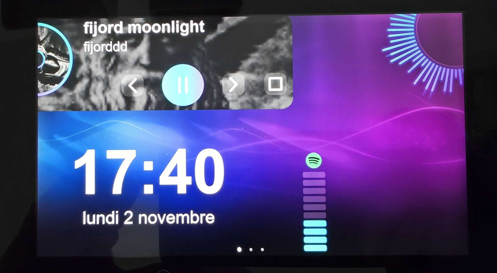 Now playing, visualizer, Voicemod, audio output |
| 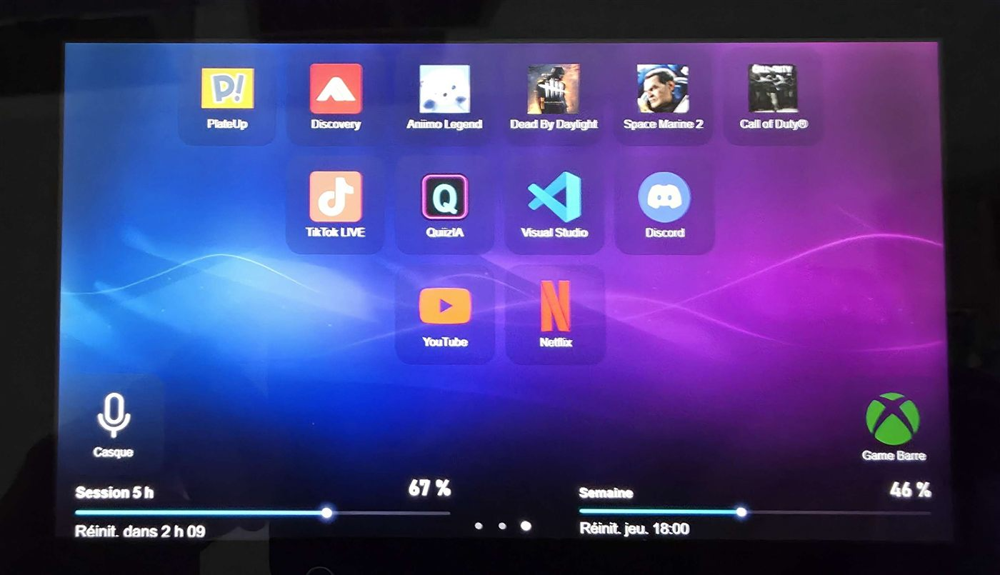 Stream Deck-style tiles: textured plate, recessed glass buttons | 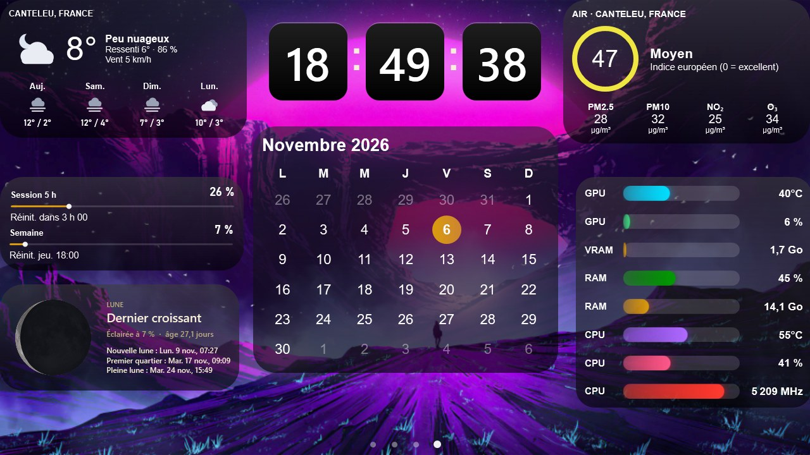 Weather, flip clock, air quality, calendar, moon, Claude quota, sensor bars |

### Installation

Copy `payload/output/switchdeck.bin` to `sd:/bootloader/payloads/` and launch it from hekate (**Payloads**).

Windows installs the WinUSB driver automatically through Microsoft OS descriptors.

> The payload runs directly on the hardware. It does not touch the console's NAND or system software, but use it at your own risk.

## Connected apps (stream deck)

In **Settings → Applications connectées** (connected apps), **+ Ajouter une application** enables OBS Studio, Twitch, or Voicemod.

You can then create tiles of that type from the Switch page's action library. Tiles show the live state (active scene, streaming or recording, mode on, mic muted…) and are dimmed while the app is not connected.

| App | Connection | Tile actions |
|---|---|---|
| **OBS Studio** | OBS 28+ WebSocket server (**Tools → WebSocket Server Settings**): host, port, password | Switch scene, stream, record and pause, virtual camera, replay buffer and save, mute an audio input, show/hide a source, Studio Mode transition |
| **Twitch** | "Se connecter à Twitch": confirm a code on Twitch; no password in SysDeck | Clip (link copied), marker, chat message, ad, chat modes (slow, emote-only, followers, subscribers), Shield Mode, title, category |
| **Voicemod** | Voicemod running on the PC; allow SysDeck in Voicemod the first time | Voice changer, load a voice, random voice, play a soundboard sound, stop sounds, mic, Hear Myself, background effect |

### Additional actions

- **Typing on the Switch**: a Twitch message, title, or category tile can ask for its text when pressed. An AZERTY keyboard then opens on the Switch, with the account's Twitch emotes, emojis, and a category search with box art. From the desktop, a small input window opens on the PC instead.
- **Voicemod**: voices and sounds are picked from Voicemod's own lists and use their picture as the tile icon. Sounds are grouped by soundboard, with your own first.

## Plugins and icon packs

- **Plugins**: a plugin is a small program (EXE, Node.js, Python, or PowerShell) that communicates with SysDeck over a local WebSocket. Its actions appear in the Switch page's action library. It can update its tiles' title, image, and state live.
  - **Catalog** (Settings → Plugins): GitHub search (topics `sysdeck-plugin` and `streamdeck-plugin`), one-click installation of the latest release, and updates. "Verified" plugins are listed in [`plugins/catalogue.json`](plugins/catalogue.json).
  - **Elgato Stream Deck plugins**: open-source plugins (unencrypted `.streamDeckPlugin` or `.sdPlugin` folder) work, with their property inspector shown in the tile inspector (WebView2). Node.js is downloaded once if the PC has none. Elgato Marketplace plugins are encrypted and do not work; neither do dial actions (Stream Deck +).
  - **Writing a plugin**: see [`docs/plugins.md`](docs/plugins.md) (French) and the [`plugins/exemple-compteur`](plugins/exemple-compteur) sample.
- **Icon packs**: in a tile's icon chooser, **Pack d'icônes…** imports a Stream Deck icon pack (`.streamDeckIconPack`, SVG icons included), a